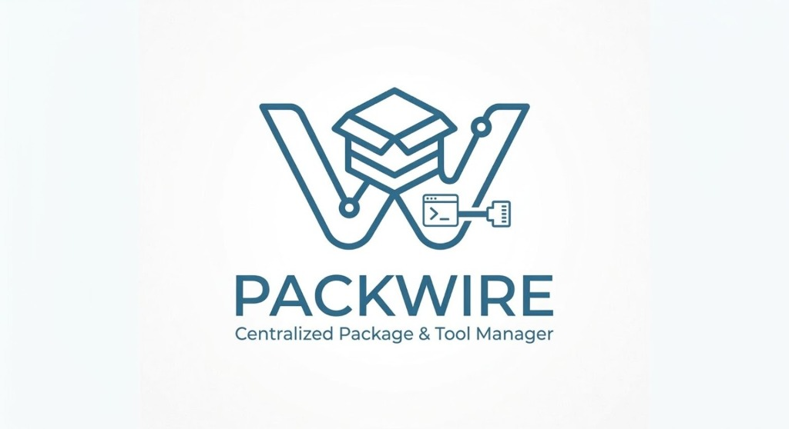
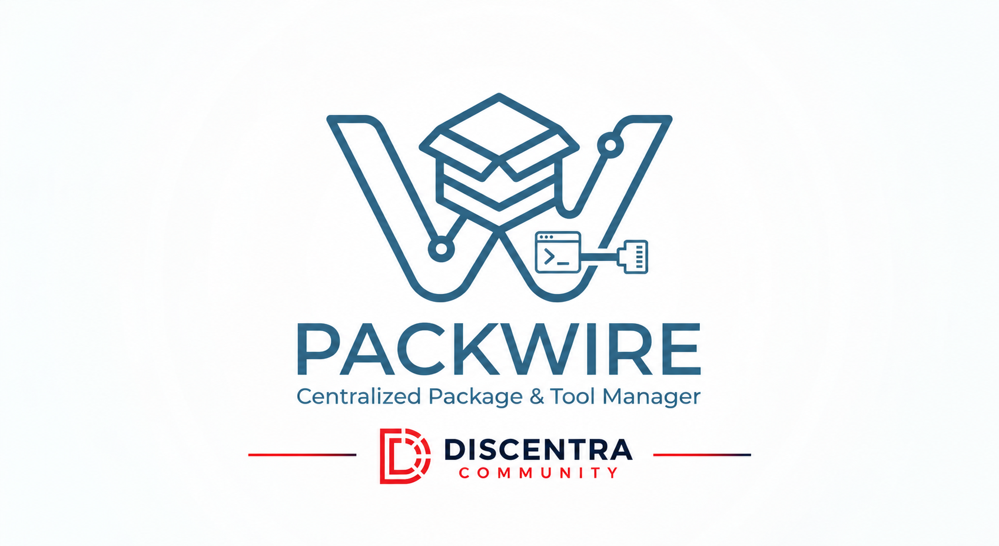

<p align="center">
  
</p>

# Packwire

Packwire es un gestor moderno de aplicaciones y herramientas para Windows. Desde una sola interfaz permite descubrir, descargar e instalar paquetes, lenguajes de programación, runtimes, herramientas de desarrollo y sistemas operativos.

Su objetivo es simplificar la preparación de un equipo nuevo: Packwire reúne el catálogo, la instalación y la administración de las aplicaciones en un solo lugar.

## Características

- Catálogo organizado por categorías.
- Instalación directa de paquetes desde sus fuentes oficiales.
- Selección de versiones estables y versiones específicas cuando están disponibles.
- Secciones independientes para herramientas, sistemas operativos y aplicaciones.
- Detección de aplicaciones instaladas y aplicaciones administradas por Packwire.
- Interfaz gráfica moderna y aplicación de consola para tareas rápidas.
- Descargas en segundo plano con consola oculta cuando la instalación lo permite.
- Gestión de accesos y shims para facilitar el uso de las herramientas instaladas.
- Verificación de actualizaciones de Packwire.

## Contenido del catálogo

Packwire puede ofrecer, entre otros:

- Lenguajes: Python, Rust, Go, Java, Node.js, Ruby, PHP, Dart, Julia, R y Zig.
- Herramientas: Git, CMake, LLVM, GCC, Clang, Docker, PowerShell, Terraform y GitHub CLI.
- Utilidades: 7-Zip, FFmpeg, SQLite, jq, ripgrep, fzf, Ninja y Make.
- Sistemas operativos y herramientas para crear medios de instalación.
- Aplicaciones disponibles mediante sus instaladores o sitios oficiales.

## Instalación

Descarga la versión estable más reciente desde [GitHub Releases](https://github.com/GrandKenzy/packwire/releases/latest).

Para Windows están disponibles:

- **Instalador:** configura Packwire y crea sus accesos directos.
- **Versión portable:** permite ejecutar Packwire sin instalación.

La versión actual es **1.0.0**.

## Uso

Abre `packwirew.exe` para utilizar la interfaz gráfica. Desde ella puedes explorar el catálogo, consultar versiones, instalar aplicaciones y revisar el estado de las instalaciones.

También puedes usar la consola:

```powershell
# Ver el catálogo disponible
packwire available

# Instalar una aplicación
packwire install git

# Listar aplicaciones instaladas
packwire list

# Consultar información de un paquete
packwire info python
```

## Ficha técnica

| Característica | Detalle |
|---|---|
| Nombre | Packwire |
| Versión estable | 1.0.0 |
| Plataforma principal | Windows |
| Interfaz | GUI nativa y CLI |
| Catálogo | Herramientas, lenguajes, runtimes, utilidades y sistemas operativos |
| Distribución | Instalador y versión portable |
| Licenciamiento de aplicaciones | Cada paquete conserva las condiciones de su distribuidor oficial |

<p align="center">
  
</p>
